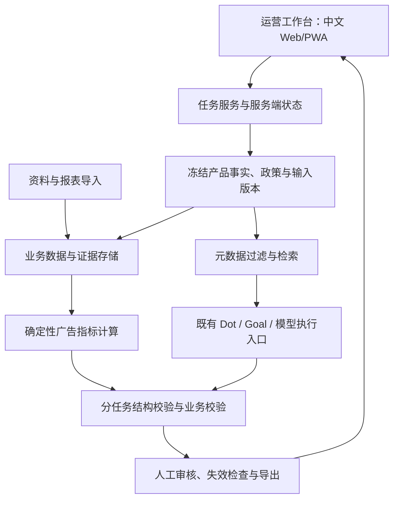
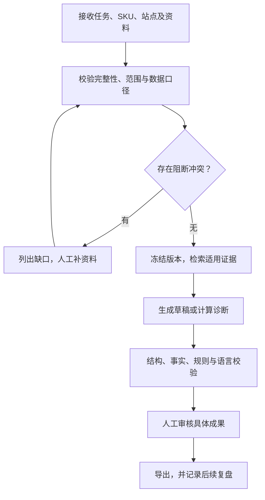

# OpenDot 跨境电商运营 Copilot：架构与设计思路

> 日期：2026-11-12。面向 Amazon 上新及运营协作，中文界面，支持美国站 en-US 与德国站 de-DE。  
> 本文是拟议架构，依据已提供的 OpenDot 产品资料及招聘 JD；尚未获得源码，也没有声称已接通平台、部署或跑出 benchmark 成绩。  
> 实施前由 Plan 的 T0 核实技术栈及现有接口，建立真实路径映射。本文中的组件名表示职责，不代表已经存在的源文件。

## 1. 产品定位与问题

目标用户是跨境电商运营人员。一个产品从候选比较、资料整理、英文/德文 Listing，到广告素材、报表诊断和售后答复，通常重复复制同一批规格和政策。复制过程中容易混淆站点、型号、功率和承诺；生成结果缺少来源，政策更新后旧文案仍继续使用；广告数据计算口径不一致，业务人员难以确认模型建议是否可靠。

本期交付一个共享事实、政策、证据与审核记录的运营工作台。运营人员提供资料，选择任务和目标市场，系统完成有边界的分析或草稿，列出依据与缺口，经人工审核后导出。平台提交、广告调整和客服消息发送由运营人员在现有业务系统执行。

P0 包含五种任务，统一使用 `contracts/task-result.schema.json`，并在同一产品工作区串联：

| task_type | 解决的问题 | 核心产物与边界 |
|---|---|---|
| `research_brief` | 候选产品和竞品材料散乱 | 对已提供候选做证据对比、差异及待验证问题；不预测销量、不自动采购 |
| `listing_pack` | 规格重复录入、多语言生成不稳定 | 站点对应的标题、卖点及描述草稿，带事实依据、规则校验和缺失项 |
| `ad_pack` | 广告文案和词组建议重复劳动 | 按指定广告格式提供创意草稿、卖点变体和词组建议；不创建 Campaign |
| `ads_diagnosis` | 广告报表清洗、计算和解释耗时 | 确定性指标、异常证据、可能解释和人工操作建议；不自动改价或调整投放 |
| `support_draft` | 售后答复语言与政策不一致 | 基于订单上下文、产品事实和政策的回复草稿，缺证据时补问或转人工 |

示例数据使用两个完全虚构、相互独立的 SKU：美国款 120 V / 1500 W，德国款 230 V / 2000 W。二者用于检验站点及规格隔离，不能当作用户真实产品资料，更不能把一个 SKU 的属性自动翻译成另一个 SKU 的属性。

## 2. 设计取舍：共用业务底座，任务各有边界

五个任务应共享产品事实和政策检索，但保留各自输入要求、校验器与输出分支。Listing 中使用的功率、广告中的加热描述及客服的使用答复，必须指向同一版已确认产品事实。这样既减少重复录入，也能在资料修订后追踪受影响的全部草稿。

工作区中主要保存以下对象，具体字段名和类型以共享契约及 Issue 为准：

- **产品档案与事实修订**：产品/SKU、适用站点、型号、规格、包装清单、批准状态、来源及修订号。未知值保持未知。
- **知识文档与政策版本**：适用市场、商品类型、语言、生效区间、权威等级、审核状态、来源 URL/上传记录、版本及内容哈希。
- **输入数据集**：广告/业务报表、候选产品、竞品材料、脱敏工单，记录范围、时间、粒度、币种及导入映射。
- **任务、运行和成果修订**：任务类型、冻结上下文、输入版本、工具记录、模型配置、成本、结构化产物及验证结果。
- **审核与导出记录**：审核人、审核时间、具体产物修订/哈希、当时依赖的事实/政策版本，以及最终导出内容。

每个输出事实都需要证据引用。自有产品规格、竞品描述、用户评论和模型推测分开记录；竞品具备某功能不能成为自有产品也具备该功能的证据。运营经验可以帮助提出建议，但不能覆盖官方规则或制造商已确认的规格。

## 3. 逻辑架构

模型负责语言生成、归纳和解释；服务端负责权限、数据口径、任务状态、版本依赖及审核判定。成果必须经过同一共享 JSON Schema 和相应业务校验器，才进入可审核状态。模型不能通过生成 `approved=true` 或类似文字改变服务端审核结果。

不为五个任务各自建立一套 Agent 平台。OpenDot 的模型配置、工作区、工具执行、审批、Goal、持久运行、日志和用量分析优先复用。源码中的实际复用入口由 T0 查证；若某能力仅在产品资料中出现，必须登记“待验证”，不能据此跳过实现或测试。

## 4. 数据源及可用性

第一版采用“用户授权资料与报表导入优先”。这样可以在没有平台开发者权限时验证真实业务结构，也能将数据获取问题与生成质量问题分开处理。

| 数据 | 第一版输入 | 用途与限制 |
|---|---|---|
| 自有产品事实 | 人工确认的事实表、说明书、包装资料、测试资料 | 作为自有规格证据；声明或认证必须有对应产品/站点的有效证据 |
| 历史 Listing 与品牌规范 | 运营人员授权上传的历史版本、术语表 | 提供风格和术语；历史出现过的说法不自动视为正确 |
| 平台/站点规则 | 官方文档快照、已审核政策文件、产品类型 schema | 按站点、类型和有效时间过滤；不宣称覆盖全部平台审核规则 |
| 广告数据 | 已导出的搜索词、投放及 Campaign 报表 | 记录广告产品、账户、归因窗口、粒度、日期范围及币种；不拼出不存在的指标 |
| 业务数据 | 销售/流量/库存报表 | 只描述授权账户的经营情况；不当作竞品销量来源 |
| 竞品材料 | 人工提供链接摘录、公开产品信息、经授权导出 | 用于对比；保留观察时间及来源，不保证实时或全网完整 |
| 客服材料 | 脱敏工单、订单状态摘要、商家政策 | 生成草稿；不能虚构已退款、已补发或承诺未批准补偿 |

### 官方 API 与公开研究数据

- **SP-API Product Type Definitions** 提供商品类型与站点对应的属性/schema，要求卖家授权及 Product Listing 角色。应保存获取时间、适用范围和 schema 版本；通用 schema 不能替代卖家特定配置，也不能等同于完整文案审核规则。来源：[官方教程](https://developer-docs.amazon/sp-api/docs/retrieve-a-product-type-definition)。
- **销售与流量报告**的 `GET_SALES_AND_TRAFFIC_REPORT` 面向卖家，要求 Brand Analytics 角色，提供销售、流量等 JSON 数据。具体权限按报告核实，不能把整个目录中其他报告的条件机械套用。来源：[Analytics Reports](https://developer-docs.amazon/sp-api/docs/report-type-values-analytics)。
- **Amazon Ads API** 需要独立申请和广告主授权。SP-API 接通不代表广告 API 也已接通；后续两类连接器分别管理权限和能力状态。来源：[API 说明](https://advertising.amazon.com/about-api)、[授权说明](https://advertising.amazon.com/API/docs/en-us/guides/account-management/authorization/authorization-grants)。
- **Amazon ESCI** 适合检验查询与产品相关性、候选替代关系。官方仓库提供 E/S/C/I 标签与英语/日语/西班牙语数据，并声明 Apache-2.0。它不是当前商品目录，也不提供德国文案事实或实时价格。保持原始切分、许可与归属，抽样报告不能冒充完整官方成绩。来源：[官方数据仓库](https://github.com/amazon-science/esci-data)。
- **Amazon Reviews 2023** 可作为可选研究资料，但作者明确表示无法为数据指派许可、主要面向研究提供。不能把代码仓库的 MIT 许可当评论数据商用许可；P0 不随商业演示包默认分发该数据。来源：[项目页](https://amazon-reviews-2023.github.io/index.html)、[作者许可说明](https://huggingface.co/datasets/McAuley-Lab/Amazon-Reviews-2023/discussions/1)。

没有凭证时，API 能力显示未配置，继续使用明确标记的导入或 fixture。导入数据、真实 API 返回和合成示例分别报告，不能互相替代在线接入验收。

## 5. RAG 与事实治理

### 5.1 先过滤，再检索

每次任务先确定 workspace、SKU、站点、商品类型、目标语言和 as-of 时间。服务端按这些元数据筛选，再做词法检索；若项目已经存在可用 embedding/向量能力，则复用作混合检索，不新增独立向量平台。

数值规格从结构化事实读取，广告指标由代码计算，检索主要用于政策条款、说明书段落、品牌术语和历史经验。不能把整个资料库全文交给模型，让模型自行猜测哪个站点或型号适用。

每个检索片段保留文档 ID、修订号、内容位置、有效区间与来源。引用必须能定位支持内容，不能只附一个首页链接。过期规则、其他站点规则、未批准规格及不适用 SKU 的片段不得进入可支持事实的上下文。

### 5.2 冲突与缺失

权威等级按事实领域定义：平台政策以适用官方政策为先；产品规格以该 SKU 已确认资料为先；客服补偿以商家有效授权政策为先。较新的低权威文章不能自动覆盖较旧但仍有效的官方规则。

同一 SKU 出现两个已批准但冲突的功率，或政策存在重叠有效版本时，应返回具体冲突，阻断相关确定性声明。允许生成不依赖冲突字段的受限草稿，但必须明确缺口并阻止审核通过完整成果。无资料支持时补问或保持空值，不补写认证、性能或退款结果。

## 6. 统一结构化输出与版本失效

所有任务输出必须符合 `contracts/task-result.schema.json`。本文件只解释语义，字段拼写、枚举和条件约束以共享 Schema 为准。输出应表达任务类型、目标上下文、产物、证据、缺失/冲突、校验结果，以及输入版本依赖；不同任务有各自 payload 分支。

同时保存 JSON 与供人阅读的预览。Markdown、表格或下载包由同一个已校验结果渲染，避免模型分别生成两份内容而出现规格或数值不一致。模型格式修复次数受既有预算约束，失败显示具体原因，不静默回退为未校验文本。

任务和审核状态由服务器管理。只有有权限的人工操作可以批准具体成果修订。产品事实、政策、知识文档或报表修订发生变化时，服务器检查依赖图，将受影响成果标记 stale；旧审批失效，旧导出仍保留历史证据，但不再显示为当前可发布版本。重新生成和重新审核后才可得到新的有效导出。

批准必须绑定内容哈希及依赖版本；编辑文案、切换站点或替换证据都需要重新审核。重复执行、重复点击审核及恢复运行应使用现有幂等设施，不能创建多份看似独立的有效成果。

## 7. 广告诊断与客服的业务规则

广告数据先经过代码校验和聚合，模型只读取计算结果及相关上下文。CTR、CPC、ACoS、ROAS 等由明确公式计算；分母为零时返回空值/不适用及原因，不能把除零结果写成 0。比率应由可加总的原始指标重新计算，不能平均各行百分比。

不得混合不同币种、账户、站点、粒度、广告产品或归因窗口；重叠期间的报表不得直接相加。广告归因收入与业务总销售额不是独立收入，不能相加当总营收，也不能直接相减得出准确自然销售额。未知或不完整的归因窗口应阻断强结论。

Amazon 官方说明归因指标在回溯窗口结束前仍不完整，因此近期零转化只能形成观察提示，不能自动建议否定或停投。建议需展示依据、样本量、观察期、适用规则和待验证假设。平台来源：[广告归因说明](https://advertising.amazon.com/help/GX7KDKHMWQYMJ385)。

客服草稿必须区分用户陈述、工具/订单事实和商家政策。资料只表明退款申请已提交时，不能写“退款已到账”；没有物流承诺时不能编造到货日期。涉及电器危险、政策外补偿或无法确认订单情况时，输出需要人工处理的原因和最小补问项。真实个人信息在进入模型和评测日志前脱敏，原始资料的访问沿用现有权限。

## 8. 业务 SOP

任务之间通过共享对象传递经确认资料，不自动把上一任务全部推测升级成事实。research_brief 的候选差异可以帮助选定 SKU；listing_pack 使用选定 SKU 已确认事实；ad_pack 使用已审核卖点；ads_diagnosis 用真实报表验证问题；support_draft 依据同一版产品资料与商家政策答复。用户可单独执行某一任务，缺少上游证据时明确补齐要求。

## 9. Benchmark 设计

评测分成能力与业务两层。ESCI 可以测检索/相关性，但不能代表 Listing 合规、客服正确或运营收益。P0 另建有标准依据的任务集，覆盖五个 task_type、US/DE、缺资料、政策冲突、规格串站、未知归因窗口、重复导入和草稿失效。

指标包括结构通过率、事实支持率、关键规格错误、检索召回/排序、规则命中、广告计算准确率、客服政策一致性、合理补问、审核与恢复状态、每成功任务成本和延迟。事实校验与数值计算采用确定性断言，语言自然度和建议可用性由业务人员盲评；模型评审只能辅助。

固定产品家族/时间切分、数据哈希、模型/提示词/规则版本。标签与评分器不进入被测 Agent 的工具、文件或记忆。基础单提示、共享证据+SOP、持久协作方案在同输入与预算下比较；多 Agent 的额外成本单列。真实、脱敏真实、合成数据分别报告，未完成人工复核的案例不能声称真实业务有效性已验证。所有门槛是工程目标，不能预填成绩。

## 10. 部署、可观测和展示

使用 OpenDot 既有单机启动/容器方案，复用数据库、证据存储、worker、模型网关和权限。T0 根据真实仓库确定文件位置与运行命令；不强制增加 Redis、独立向量数据库或 Kubernetes。模型调用由现有提供方配置决定，自托管不意味着数据没有发给外部模型，部署说明需明确数据流向。

每次运行记录任务类型、站点、SKU、依赖修订、模型/规则版本、检索证据、工具错误、Token/成本、等待与执行耗时。成本未知时显示 unknown，不记为零。服务重启后能够恢复阶段，保存过的成果不重复创建。备份必须同时恢复业务记录及证据引用，功能开关关闭后原有聊天、Goal 和审批仍可使用。

三条演示：

1. **正常上新**：导入虚构 US/DE 两 SKU 和适用规则 → 生成对应 Listing/广告草稿 → 展示功率隔离与来源 → 人工审核 → 导出。
2. **运营诊断**：导入脱敏/合成报表 → 展示代码计算与样本口径 → 生成诊断 → 加入未知窗口/混币种错误 → 正确阻断并给出修复建议。
3. **变更和售后**：先审核草稿 → 修改产品事实或有效政策 → 展示成果 stale、旧审批失效 → 客服收到缺物流/退款证据的问题 → 输出补问或转人工，补资料后重新生成与审核。

## 11. 与 JD 的对应关系

| JD 能力 | 本项目可展示的证据 |
|---|---|
| LLM 电商提效工具 | 五类任务使用同一产品/政策/审核底座，具有真实导入和导出链路 |
| RAG 领域知识库 | 按站点、SKU、类型、生效时段过滤，检索可定位证据，冲突可阻断 |
| Agent 多步骤流程 | 有边界的计划、工具、生成、校验、人工审核、版本失效与恢复 |
| 业务产品化 | 清晰解决重复资料处理、规格错误、报表口径和售后承诺问题 |
| 模型评估与优化 | 同输入对照、结构/事实/规则/成本/延迟指标及失败案例 |
| 内部赋能 | SOP、示例资料、三条演示、部署/故障手册及运营使用说明 |

Fine-tuning 不作为 P0 要求。先用检索、事实治理、确定性校验和可重复评测定位问题；只有积累足够合法且经过复核的数据、证明提示词或检索无法解决具体缺陷时，才提出独立训练实验。
