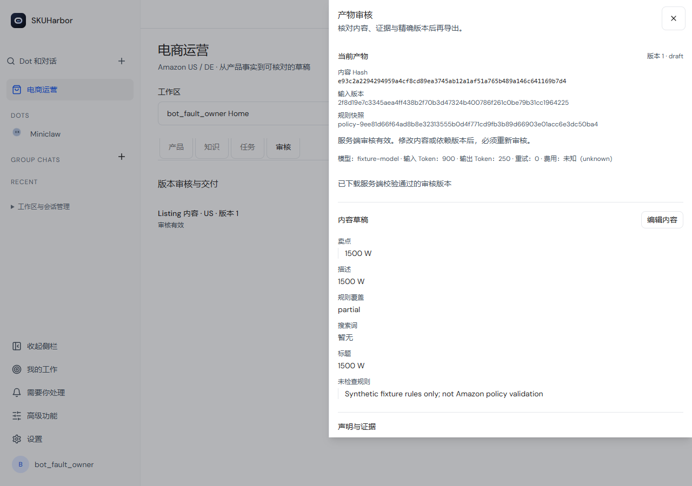
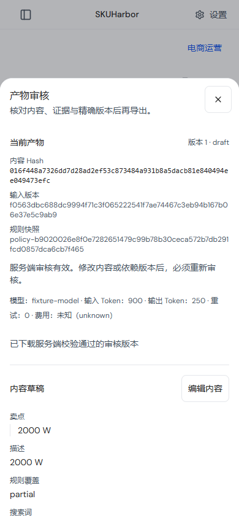

# SKUHarbor

**跨境电商运营 Copilot：从商品事实、规则证据到人工审核交付。**

SKUHarbor 基于 [OpenDot](https://github.com/helsome/OpenDot) 二次开发，复用其账号、工作区、模型配置、Web/PWA、桌面外壳及通用 Agent 能力，新增 Amazon US / DE 的电商领域工作台。当前是本地可运行的业务流程初版（PoC），不是已通过真实业务验收的自动运营系统。

产品名为 **SKUHarbor**，npm 主包名为 `skuharbor`，当前语义版本为 `1.0.0`。旧 `MINICLAW_*` 环境变量、数据目录、MCP 名称和桌面 profile 标识保留兼容；已有自定义站点名、Agent 昵称不会被改名覆盖。

## 当前能力

登录后进入 **电商运营**，路径为 `/ecommerce-ops`，选择可访问的工作区。

| 页面 | 能做什么                                                      |
| ---- | ------------------------------------------------------------- |
| 产品 | 导入来源，建立 US/DE SKU，人工确认事实，发现冲突并保留证据    |
| 知识 | 管理站点/产品适用范围、来源、版本、生效与已知时间             |
| 任务 | 创建候选研究、Listing、广告文案、SP 报表诊断和客服草稿任务    |
| 审核 | 查看证据、改稿、审核精确版本、导出 JSON/Markdown/广告诊断 CSV |

任务复用已确认事实与适用规则；广告金额和比例由代码计算；输入或规则变化会令旧稿与审核失效。支持补料恢复、幂等请求、检查点与暂停/取消。所有读取、修改和导出受工作区授权控制。

以下截图来自改名后的隔离浏览器测试，仅展示品牌、桌面/手机布局和审核流程；内容由 synthetic Provider 生成，不代表真实模型已能交付可用 Listing。




P0 采用授权文件导入，模型只生成草稿与解释。Listing、广告和客服按单 SKU/站点绑定；SP-API / Ads API 尚未接入，没有上架、改价、改预算、退款、补发或发送客服消息的场景端点。人工 Goal 跟进需要原功能开关并手动推进。

## 实际进度与限制

- 历史完整场景检查通过：140 项单元、77 项集成、3 项浏览器测试；故障编号 B01–B24 为 24/24。浏览器使用合成 Provider，测试集合有重叠，不能当作独立真实业务样本相加。
- 真实模型同输入对照：通用提示 A25/60，SOP B21/60，内容质量未达标。这些通过分数包含正确补料；两组 Listing 均 **0/15 进入待审**，不能宣传为已生成 10/6 份可用 Listing。
- 原相关回归保留 3 项 Windows 权限/mode 失败；整体工程/演示验收 A 尚未通过，真实业务试运行 B 与经营收益 C 未验证。模型评测变体 A/B/C 与验收等级 A/B/C 是两套命名。
- 原聊天仍是默认首页，普通聊天尚未接电商任务调度；手机聊天入口和首个任务引导是已知体验缺口。当前需要自行进入工作台并导入资料。
- PDF 依赖 `pdftotext`，本机真实二进制提取尚未验证。费用无可靠价格版本时记为 unknown。

完整证据与边界见 [验收记录](docs/ecommerce-ops/acceptance.md)、[项目阶段汇报](docs/ecommerce-ops/REPORT_TO_WEB_CHATGPT.md)；GitHub 读者可下载 [脱敏阶段证据包](docs/ecommerce-ops/evidence/README.md)，历史 `artifacts/` 路径只用于本机定位。下一轮单 SKU Listing 目标见 [评审与计划归档](docs/ecommerce-ops/next-slice/README.md)，**尚未实施**。

## Windows 启动

使用 **Node.js 24**；安装依赖和启动应使用同一 Node 大版本。当前本机依赖为 Node 24.15.0 / ABI 137，使用 Node 22 / ABI 127 会导致 `better-sqlite3` 原生模块加载失败。已有安装先备份自己的 `data/`，不要删除业务数据解决版本问题。

```powershell
git clone https://github.com/icearia0219/SKUHarbor.git
cd SKUHarbor
node --version
npm.cmd run setup:windows
$env:OPENDOT_ECOMMERCE_OPS='true'
npm.cmd run start:windows
```

需要 Git for Windows Bash；启动脚本会自动查找。新安装按照应用引导创建管理员、配置自己的模型 Provider 和工作区；密钥只保存在本机配置，不提交 Git。当前仓库为私有仓库，克隆需要对应 GitHub 访问权限。

打开 `http://127.0.0.1:3000`，登录后进入 `http://127.0.0.1:3000/ecommerce-ops`。场景开关默认关闭；设置环境变量后重新启动服务才生效。已有终端可直接使用启动命令，不必重复安装依赖。普通 `npm run build:all` 只构建代码，不会为不同 Node ABI 重编原生依赖。

详细安装、Node 路径、持久化备份与回退见 [部署说明](docs/ecommerce-ops/deployment.md)。原通用聊天、渠道、Host/Docker 与桌面启动说明保留在 [OpenDot 上游 README 档案](README_OPENDOT_UPSTREAM.md)。

## 测试与演示

在项目根目录执行；工程测试使用自己的临时数据库和服务，不重置用户业务工作区。all 包含构建，会更新 dist，建议在开发副本运行。

```powershell
node scripts/ecommerce-check.mjs unit
node scripts/ecommerce-check.mjs integration
node scripts/ecommerce-check.mjs e2e
node scripts/ecommerce-check.mjs all
```

三条合成演示使用真实领域函数和 SQLite，模型与审核身份为明确标记的 fixture，不代表真实模型/真人验收，也不会向正式 UI 灌演示数据：

```powershell
node scripts/ecommerce-demo.mjs --workspace demo-launch-us-de --reset --scenario launch-us-de
node scripts/ecommerce-demo.mjs --workspace demo-conflicting-evidence --reset --scenario conflicting-evidence
node scripts/ecommerce-demo.mjs --workspace demo-operations-boundaries --reset --scenario operations-boundaries
```

reset 只允许受限目录下有 marker 的 demo 工作区。报告、SQLite 和导出保留在本地 `artifacts/`；该目录以及用户 `data/`、配置密钥、日志、依赖和构建产物不上传 Git。当前 GitHub workflows 沿用手动触发方式，上传成功不代表 GitHub CI 已执行。

## 技术栈与目录

React 19 / TypeScript / Vite / Tailwind / Zustand；Node / Hono / Zod；better-sqlite3 / SQLite；JSON Schema 2020-12 / AJV；既有 Pi/Provider 模型 SDK；Vitest / Playwright。

| 目录                                | 职责                                                       |
| ----------------------------------- | ---------------------------------------------------------- |
| `src/ecommerce-ops/`                | 事实、知识、报表计算、模型适配、工作流、质检与审核导出     |
| `src/routes/ecommerce-ops.ts`       | 对接现有认证、工作区权限与人工 Goal                        |
| `web/src/components/ecommerce-ops/` | 产品、知识、任务及审核视图                                 |
| `docs/ecommerce-ops/`               | 需求、方案、契约、模板、培训与验收                         |
| `benchmarks/ecommerce-ops/`         | 合成数据、隔离被测执行与私有评分输入；金标不提供给被测模型 |

真实路径与符号见 [repo-map](docs/ecommerce-ops/repo-map.md)，日常操作见 [培训说明](docs/ecommerce-ops/training.md)。

## 来源与许可证

SKUHarbor 是基于 [helsome/OpenDot](https://github.com/helsome/OpenDot) 的电商场景二次开发，不将原有通用平台能力声明为本项目从零开发。原版权声明和 [MIT LICENSE](LICENSE) 保持不变；第三方依赖、资料和服务有各自许可与条款。

历史评测、上游文档、兼容协议和旧标识中的 OpenDot/Miniclaw 名称作为来源及版本记录保留，不表示当前产品品牌仍为旧名。
